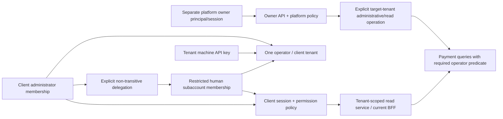

# Gateway ownership and delegated client access — proposed architecture

**Status: design proposal for PR #20; independent review and explicit approval required before implementation.** No permissions, routes, accounts, migrations or feature flags are enabled by this document. Baseline: merge `6a9ade1` (PR #19) on `feature/step-1-project-setup`. Keep `LIVE_MODE_ENABLED=false`, `ALLOWED_PROVIDERS=simulator`, `DASHBOARD_ENABLED=false` and `DASHBOARD_BFF_ENABLED=false`.

Companion specifications: [schema and migration plan](gateway-access-schema.md), [threat model and acceptance tests](gateway-access-threats.md). Together these constitute the architecture, permission matrix, authorization/API design and phased plan.

## 1. Verified current implementation

These are repository facts, not evidence about a deployed environment. No Render/database access was performed. Line references refer to the baseline above.

| Area                         | Evidence                                                                                                                                                                                                            | Current behavior and design implication                                                                                                                                                                                                                               |
| ---------------------------- | ------------------------------------------------------------------------------------------------------------------------------------------------------------------------------------------------------------------- | --------------------------------------------------------------------------------------------------------------------------------------------------------------------------------------------------------------------------------------------------------------------- |
| Client boundary              | `migrations/001_initial_schema.sql:1–34`                                                                                                                                                                            | `operators` are flat tenants; each payment has a required operator FK. Idempotency is unique per operator. Retain these names and IDs.                                                                                                                                |
| Human identity               | `migrations/004_dashboard_auth.sql:2–16`                                                                                                                                                                            | Global unique usernames; one membership per user (`user_id` PK); membership role can only be `viewer`. Several users can share an operator. A subaccount should be a human membership, not another operator.                                                          |
| Sessions                     | `migrations/004_dashboard_auth.sql:17–69`, `src/dashboard/sessions.ts:25–66`                                                                                                                                        | Hashed sessions bind user and membership; active user/operator and current auth version are checked. Password/status/membership changes and operator suspension invalidate sessions. No owner realm exists.                                                           |
| Authentication               | `src/dashboard/routes.ts:95–279`, `src/dashboard/passwords.ts:4–20`                                                                                                                                                 | Argon2id, dummy verifier, CSRF/pre-auth token rotation, generic failures, PostgreSQL throttles, Secure/HttpOnly/SameSite=Lax host cookie. Idle 30 minutes; absolute eight hours; pre-auth ten minutes. `/me` returns a fixed viewer role, not delegated capabilities. |
| API keys                     | `migrations/002_operator_api_keys.sql:3–16`, `003_api_key_permissions.sql:1–4`, `src/db/operator-keys.ts:71–121`                                                                                                    | One tenant per hashed key; `read_only` and `read_write`; revoked keys and suspended tenants are denied. Existing keys default to read/write. Machine scopes are not human roles.                                                                                      |
| Administrative helper        | `src/db/operator-keys.ts:24–55`, `src/cli/staging-operator.ts`                                                                                                                                                      | The creation helper creates an operator **and** a key, defaulting to read/write. Do not reuse it as an automatic client-onboarding endpoint. The staging CLI is not an owner-account or delegation API.                                                               |
| Payment API                  | `src/payments/routes.ts:31–128`, `src/db/payments.ts:41–162`                                                                                                                                                        | Bearer-only tenant context; reads and updates include operator predicates; creation/idempotency and simulator transitions already exist. Cookies do not substitute for API keys.                                                                                      |
| Dashboard BFF                | `src/dashboard/bff.ts:37–100`, `src/dashboard/gateway-reader.ts`, `src/payments/internal-read.ts`                                                                                                                   | GET-only, active session and one configured operator/read-only server key, fixed loopback destination. Signed restrictions bind expected tenant/read-only permission at upstream key authentication. One operator and one Node process per current BFF configuration. |
| Frontend lifecycle           | `frontend/src/auth.ts`, `frontend/src/main.tsx`                                                                                                                                                                     | App-owned authentication phases, Web Locks, advisory secret-free BroadcastChannel notices, generation-bound callbacks and identity-scoped view remounts. No owner UI or write controls. Preserve these safeguards.                                                    |
| Database and logs            | `src/db/pool.ts:4–10`, `src/db/migrate.ts:11–85`, `src/shared/logger.ts:15–58`                                                                                                                                      | Pool TLS derives from connection configuration; migration runner serializes and transacts migrations. Pino redaction/request logs are present; no dedicated append-only administrative audit schema exists. Redaction does not make arbitrary logged values safe.     |
| Existing regression evidence | `tests/integration/dashboard-auth.test.ts`, `dashboard-bff.test.ts`, `app.test.ts`, `key-permission-migration.test.ts`, `staging-provisioning.test.ts`, `dashboard-browser.test.ts`, `frontend/tests/auth.test.tsx` | Existing tests exercise viewer isolation, suspension/revocation, scope binding races and browser lifecycle. They do **not** establish security for unimplemented owner/delegation features.                                                                           |

## 2. Relationships and boundaries

`operator` remains the database/API's technical tenant term; “client” is the product label. A restricted subaccount is a human user in the **same** operator, not a child tenant, merchant, wallet or separate settlement account. No financial account hierarchy or funds segregation is implied.

For migration 005 / PR #21, retain the existing one-membership-per-user structure and `dashboard_memberships.user_id` primary key. Disablement retains that membership row, permanently revokes its active grants and invalidates sessions; it is not deletion. Historical grants keep their required membership references. Old membership IDs must never be recycled or retargeted. Same-user membership replacement, tenant reassignment, deletion/recreation and multi-tenant human access are deferred to a separately reviewed history/identity migration; 005 cannot represent them safely. The future administrator/subaccount relationship below is a later target model, not an expansion of 005. A person needing owner and client duties has separate realm credentials and explicit logins. Never combine owner and client grants in one session.

Owner access is a separate principal type and route boundary. There is no `isOwner` exception inside `listPayments`, no nullable tenant meaning “all tenants,” no master operator key, no owner role inserted into client memberships, and no owner override of the public Bearer payment API. All public payment requests remain tenant scoped.

## 3. Permission catalog and matrix

Permissions are versioned, exact allowlisted identifiers. No wildcard, prefix matching, negative-grant precedence or browser-defined permission names. Roles are server-side presets/ceilings; the effective grant set is authoritative. Unknown permissions and unrecognized route actions deny access.

| Permission / action                                                                 | Gateway owner                                                      | Client administrator                                      | Restricted client subaccount                            |
| ----------------------------------------------------------------------------------- | ------------------------------------------------------------------ | --------------------------------------------------------- | ------------------------------------------------------- |
| `platform.clients.read` — list clients/metadata                                     | Yes, platform realm                                                | No                                                        | No                                                      |
| `platform.clients.manage` — onboard/suspend/reactivate client                       | Yes, step-up for writes                                            | No                                                        | No                                                      |
| `platform.clients.bootstrap_admin` — initial admin/reviewed replacement             | Yes, step-up, exceptional lifecycle only                           | No                                                        | No                                                      |
| `platform.payments.read` — selected-client or explicitly bounded cross-client reads | Yes, dedicated owner route/audit                                   | No                                                        | No                                                      |
| `platform.audit.read` — owner audit events                                          | Yes                                                                | No                                                        | No                                                      |
| `platform.owners.manage` — add/disable/recover owners                               | Separate high-risk ceremony, not ordinary owner-session self-grant | No                                                        | No                                                      |
| `client.account.self` — own minimal identity/session                                | Separate owner equivalent only                                     | Yes                                                       | Yes while active membership is valid                    |
| `client.tenant.read` — own client metadata                                          | No implicit client role                                            | Yes                                                       | Explicitly delegated                                    |
| `client.payments.read` — own tenant list and detail                                 | Owner uses `platform.payments.read`, not this grant                | Yes                                                       | Explicitly delegated                                    |
| `client.status.read` — own authorized gateway status                                | Owner-specific sanitized status route later                        | Yes                                                       | Explicitly delegated                                    |
| `client.users.read` — tenant member directory, minimal fields                       | Not general day-to-day client administration                       | Yes                                                       | Explicitly delegated; sensitive PII limited             |
| `client.users.manage_subaccounts` — create/disable restricted members               | No implicit grant                                                  | Yes; only restricted targets                              | Never delegable                                         |
| `client.permissions.delegate` — change restricted grants                            | No implicit grant                                                  | Yes, within own effective authority                       | Never delegable                                         |
| `client.audit.read` — own tenant administrative audit                               | Owner platform audit route                                         | Yes                                                       | Explicitly delegated; sanitized target metadata         |
| `client.branding.manage` — approved tenant branding fields                          | Owner separate review/abuse-control operation later                | Later explicit admin entitlement                          | Explicitly delegated only after branding is implemented |
| `client.keys.manage` — machine-key lifecycle                                        | No master key and no default tenant-key access                     | Later explicit entitlement; key capabilities also bounded | Not delegated in first release                          |
| `client.payments.create.simulated` / `client.payments.simulate`                     | Not granted by ownership                                           | Reserved; **not enabled by administrator preset**         | Not enabled/delegable in first release                  |
| Refund, reversal, live provider/real-money operations                               | Absent, denied                                                     | Absent, denied                                            | Absent, denied                                          |

“Yes” describes the proposed eventual authority, not functionality enabled by PR #20 or PR #21. Eligible existing viewers initially map only to intrinsic `client.account.self` and explicit `client.payments.read` / `client.status.read` grants. Disabled users/memberships and suspended tenants are ineligible at cutover; their compatibility records are retained revoked, not activated. Withdrawal of an entitlement permanently revokes matching compatibility grants. Restoring the ceiling alone never restores access, and 005 includes no regrant operation. They do not acquire directory, audit, branding or administrative grants. An administrator preset initially contains the client read and restricted-user/delegation permissions; it does not silently acquire future catalog additions. Sensitive additions require explicit entitlement and approval.

The owner has platform-wide visibility and administration through exact `platform.*` actions. That is not automatic access to client secrets, passwords, cookies, raw keys, payment writes or impersonation. Owner account management/recovery must not be delegated through the normal client or owner API.

## 4. Delegation rules and revocation

**Deferred beyond PR #21.** Migration 005 persists no client administrators, subaccounts, sponsors, root grants or delegation mutations; its role constraint remains viewer-only. A later provenance/history migration must precede persisted delegation fixtures or features. For that later model, delegation depth is one: an active client administrator grants an explicit subset to a restricted member in the same operator. Restricted members cannot delegate, promote themselves, create another administrator, change their tenant or choose a new delegator. Multiple administrators may exist later, but each restricted membership has exactly one recorded sponsoring administrator. Reassignment is an explicit audited transaction, not inheritance from whichever admin was last active.

For restricted member M, effective delegated business permissions are:

`explicit grants(M) ∩ current effective authority(sponsor) ∩ tenant entitlement ceiling ∩ delegable catalog ∩ enabled-feature allowlist`.

`client.account.self` is an intrinsic, subject-only capability after authentication eligibility succeeds; it is not an editable/delegatable grant and never exposes another user. The formula above applies to business actions. Also require active user, active membership, active tenant, a live same-tenant administrator sponsor and a valid current session. The sponsor's authority must never depend on a restricted member: no cycles. Root administrator grants come from reviewed tenant onboarding/owner administration, not client self-assignment. There is no transitive delegation graph in the initial release.

At every grant change, compute the subset on the server under transaction locks; ignore UI role labels and reject forbidden/unknown permissions. Reducing a sponsor's authority immediately caps their sponsored users at runtime. The same transaction permanently revokes affected child grants and advances their authorization versions. Suspending/removing a sponsor disables sponsored access and revokes its grants; reactivation **does not resurrect grants**. Future sponsor reassignment/regrant requires an explicit approved operation after its schema/provenance model is reviewed. Same-user membership replacement or tenant reassignment is not supported in 005. Disabling a restricted member does not delete historical evidence. An administrator cannot use this API to disable, alter or replace another administrator; last-admin recovery is an owner ceremony.

No stale session can retain an old effective grant set. Recheck policy state per request; sessions store versions, not a trusted permission snapshot. Invalidate affected sessions on password, status, membership, role, sponsor, grant or entitlement changes. Feature expansion never expands stored grants automatically.

Machine keys remain independent of human dashboard permissions, membership versions, sponsors and viewer entitlement ceilings. Current Bearer authentication continues to check its own tenant status, key scope and revocation; 005 does not add human-grant/sponsor checks to it. Withdrawing `client.payments.read` from a human does not revoke a machine key or change simulator writes. Tenant suspension still denies machine-key authentication; reactivation can allow an existing non-revoked key again under its unchanged scope, exactly as today. Explicit key revocation remains irreversible. Human grant non-resurrection is not a claim that unrevoked service credentials have been revoked.

Future client key management is separately designed/reviewed, not enabled by this catalog. At minimum, key-management authority alone must not mint stronger machine capabilities than the issuer is allowed to issue; issuer departure/downgrade, tenant-service ownership, scope preservation on rotation and approval/audit must have an explicit key-lifecycle contract. No owner master key, automatic key issuance at onboarding, hidden scope change or new credential workflow is introduced by PR #21.

## 5. Server authorization and race semantics

Introduce explicit internal types, created only by authentication/policy modules:

- `ClientContext`: user, membership, operator, authorization version, exact effective permissions, client realm.
- `OwnerContext`: platform principal, owner session/step-up state, exact platform permissions; no default operator.
- Machine context: authenticated key/operator/coarse scope, independent of dashboard sessions.

Context constructors are private to server modules; JSON, headers, query/body fields, branding hosts and frontend role labels cannot construct them. Tenant IDs in owner paths identify requested targets, not authority. Client routes derive tenant solely from the validated membership. Reject supplied operator selectors rather than silently trusting them. Repository functions require a non-null authenticated tenant and always apply `operator_id = expected`; ownership checks include both tenant and resource ID, including related users/keys/audit rows. Use explicit DTOs, bounded pagination, no-store and uniform 404 for inaccessible tenant resources. No generic proxy or generic “execute as tenant” function.

PR #21 has no public administrative mutation routes and no persisted administrator/delegation principals. Its viewer policy reads and withdrawal/invalidation semantics follow the explicit gate/lock protocol in [schema §3](gateway-access-schema.md#3-lock-protocol-and-fail-closed-write-restrictions). Production grant creation/restoration, role promotion, membership replacement and delegation are unavailable. Controlled withdrawal/invalidation helpers may be tested with verified disposable maintenance-role fixtures; that does not authorize a production maintenance tool or a test-only root-grant bypass. Later administrative writes require fresh actor/target/provenance evaluation, audit and the same protocol before enablement.

### Read authorization contract for PR #21

The human read linearization point is **successful BFF admission**, not the later payment SQL statement. In one bounded admission transaction, a valid client cookie is resolved to an active user, retained active viewer membership and active operator; session expiry/auth versions and the exact current human permission/ceiling are checked under the tenant policy gate. Payment list/detail require `client.payments.read`; status requires `client.status.read`. Commit this admission decision before releasing its DB lease and starting loopback HTTP. A policy withdrawal that commits before admission denies the request. A withdrawal that commits after admission may allow that already admitted request to finish, only for its captured original operator. Subsequent admissions fail. All authentication paths still verify current eligibility; `/me` subject-only identity does not itself authorize payment history.

The remaining boundaries are independent and cumulative:

1. The browser never supplies authoritative operator, role, permission or machine credentials.
2. BFF admission validates the human session and required current human permission as above.
3. Existing server-side key validation checks the configured read-only key belongs to that same operator.
4. The signed loopback restriction binds expected operator, required read-only **machine** permission, path, key and expiry. It contains no human identity, human permission or human policy version and must not be described as doing so.
5. Upstream Bearer authentication independently rechecks the key, tenant and signed restrictions; its captured operator scopes every payment SQL query. Status uses the existing restricted authenticated health operation.

No DB transaction/lock spans the HTTP hop. Human revocation after successful admission does not require canceling SQL or retracting an already delivered response; it never permits a different tenant or a write-enabled key. This explicit snapshot policy avoids pretending that two HTTP authorization boundaries share a transaction. If stricter cancellation or human-policy validation at upstream SQL is later required, stop and review additional signed context propagation and upstream validation as a separate change. Do not weaken key binding or claim it already exists.

Owner selected-tenant reads use a separate route/policy/repository adapter: verify platform session and action, validate active/known target metadata under policy, apply that exact target's predicate and audit the selection. The owner may investigate suspended clients through these routes; this does not reactivate client sessions or keys. Explicit platform-wide list operations use a dedicated paginated, redacted query with mandatory `platform.payments.read`; they do not call a tenant function with a missing filter. Return authoritative operator identity with each row. No owner read path can call creation, simulation, credential issuance or provider operations. Platform write actions remain separately named and require step-up and audit.

## 6. Authentication realms and browser behavior

Keep existing client passwords/sessions and PR #19 coordination, CSRF, cookie and Origin protections. The proposed owner realm uses separate principal/session/pre-auth/limiter/recovery tables, separate hash verifiers, separate cookie name (for example `__Host-vaultx_owner_session`) and explicit realm checks. Owner credentials never authenticate to client/Bearer routes, or vice versa. No role toggle upgrades an existing client session to owner.

Recommended owner UI origin is a separately approved HTTPS hostname, served by the same Express deployment if desired: no extra microservice is required. Separate host-only cookies, exact Origin allowlists, CSP and host routing prevent client-origin JavaScript from automatically exercising owner cookies. Different cookie names or paths alone on a shared origin are **not** an XSS isolation boundary. Do not expose owner endpoints on the client origin; validate the configured host at ingress/application boundaries, never infer tenant/owner authority from arbitrary Host/X-Forwarded-Host. Deployment topology and trusted proxy addresses require independent verification before enablement. If a separate owner origin is unavailable, defer owner browser functionality rather than claim equivalent isolation.

Owner access requires MFA and fresh step-up for owner changes, onboarding/admin replacement, suspension/reactivation and other sensitive writes; exact authenticator/recovery enrollment ceremony needs approval before owner implementation. Owner sessions should start with a shorter proposed policy (15-minute idle, one-hour absolute; step-up max five minutes), realm-specific rate limits, concurrency bounds and no persistent “remember me.” These durations are proposals requiring usability review. Client admin sensitive writes also require recent password/MFA step-up; tenant read-only sessions remain compatible initially. Generic failures, secret-free notices and session fixation/rotation protections apply to both realms.

Bootstrap/recovery uses an explicitly authorized offline administrative ceremony with verified environment/DB identity, random one-time enrollment verifiers, short expiry, recorded approvals and audit. No default password, public bootstrap endpoint, recovery by email address alone, or promotion via arbitrary SQL/role input. Never request real credentials in PRs. Administrator replacement and owner privilege/recovery changes require two distinct approved custodians/principals, fresh verification, target/action-bound expiring approval evidence and no self-approval. First-owner or last-owner loss cannot depend on two existing owner logins: an independently verified offline two-custodian break-glass ceremony with preserved audit evidence must be separately approved. Exact custody and unavailable-authenticator procedures must be tested before enabling these writes; PR #21 creates no accounts or recovery tooling.

## 7. API design (proposed; none implemented here)

| Route boundary                                                  | Actions                                         | Required authorization                                                                      |
| --------------------------------------------------------------- | ----------------------------------------------- | ------------------------------------------------------------------------------------------- |
| Existing `/payments` and `/payments/:id`                        | Existing machine reads/simulator writes         | Existing Bearer key, tenant predicate, coarse scope; no cookies/owner exception             |
| Existing `/dashboard-api/auth/*`                                | Client CSRF/login/me/logout                     | Existing client realm; `/me` eventually adds versioned exact permission list, never secrets |
| Existing `/dashboard-api/payments[/:id]`                        | GET only                                        | `client.payments.read` plus active client context and current upstream restriction          |
| Existing `/dashboard-api/status`                                | GET only                                        | `client.status.read`; sanitized snapshot                                                    |
| Proposed `/dashboard-api/members` and `/:membershipId`          | GET, explicit POST/PATCH lifecycle commands     | Directory/read or restricted-user management; same tenant, restricted targets only          |
| Proposed `/dashboard-api/members/:id/permissions`               | PUT exact replacement, version precondition     | `client.permissions.delegate`; subset/sponsor checks, no role/tenant changes via this body  |
| Proposed `/dashboard-api/audit`                                 | GET                                             | `client.audit.read`; own tenant, redacted, bounded                                          |
| Proposed owner-origin `/owner-api/auth/*`                       | Separate auth/step-up/logout                    | Owner realm only                                                                            |
| Proposed `/owner-api/clients[/:operatorId]`                     | GET / explicit onboarding/status commands       | Corresponding platform permission; owner write step-up/audit                                |
| Proposed `/owner-api/clients/:operatorId/bootstrap-admin`       | POST initial/replacement administrator ceremony | `platform.clients.bootstrap_admin`; no returned password/raw token in ordinary response     |
| Proposed `/owner-api/clients/:operatorId/payments[/:paymentId]` | GET                                             | `platform.payments.read`; explicit target-scoped query/audit                                |
| Proposed `/owner-api/payments`                                  | GET bounded cross-client view                   | Dedicated platform policy/query, not a missing tenant filter                                |
| Proposed `/owner-api/audit`                                     | GET                                             | `platform.audit.read`; minimization and sensitive-read audit                                |

Methods, bodies, query keys, UUIDs, grant arrays, page bounds and version preconditions are strict allowlists. No GET mutations; HEAD/OPTIONS do not bypass policy or invoke writes. Browser writes require exact realm Origin, CSRF and JSON; protect denial/error paths too. Membership mutations require expected version (`If-Match` or typed equivalent), stale updates return 409, and non-idempotent administrative creation uses tenant/actor/action-scoped idempotency with request fingerprinting. Do not return success before audit/commit. Replays never resend secrets or create duplicate grants/accounts.

## 8. BFF and frontend compatibility

PR #21 does **not** add multi-tenant routing or change the single configured read-only API key. Preserve all current read-only routes, signed tenant/scope binding, fixed destination, response/time limits, simulator-only schemas and feature gates. Backfill eligible existing viewers to the exact current read permissions and retain ineligible compatibility records revoked; `/me` role/DTO compatibility must be preserved until a separately versioned frontend update. Do not reinterpret old viewers as administrators.

For a later multi-client client dashboard, choose and review a shared in-process tenant-read service before implementation. Its client adapter authenticates session and exact permissions; its machine adapter authenticates Bearer scope; both construct trusted tenant contexts and reuse the same mandatory scoped repository. This avoids keeping decryptable raw keys per tenant and the loopback's one-operator/single-process restriction. It is a **future replacement** for the key-mediated BFF, not permission to bypass today's configured key checks in PR #21. Retire the old loopback/signature path only after equivalent tenant, scope, revocation, bounded-read and race tests pass; never remove public API Bearer auth. Owner reads are a separate adapter with explicit platform policy, not a client context fabricated from an owner-supplied ID. If the service refactor is not approved, keep the current BFF pinned to one tenant; do not use a global key or pretend key hashes can be recovered into raw credentials.

The browser may display returned permissions to explain availability, but UI hiding is never authorization. Keep the initial payment dashboard read-only even when a user's administrative role is later introduced. No tenant switching UI until the server membership model supports it. Owner and client views must not share cached data, authentication controllers, cookies or notices across origins. Context/authorization changes must clear stale views before revalidation, retaining PR #19 late-response and focus safeguards.

## 9. Onboarding, branding and lifecycle

Proposed owner workflow: create an operator without a key; record legal/display metadata separately; assign a client entitlement ceiling; authorize an initial administrator invitation/enrollment; administrator activates their own credential/MFA; restricted users are invited/delegated afterward. Invitation verifiers are hashed, short-lived, single-use and bound to tenant, target identity and intended role. Invite acceptance checks current issuer authority, tenant status and grant version at consumption; it cannot accept an obsolete stronger grant. No passwords or existing API secrets are mailed or displayed to an owner.

Tenant suspension blocks client session eligibility, machine-key authentication and new enrollment; owner investigation remains separately authorized. Reinstatement requires approval, does not revive old sessions, explicitly revoked keys or permanently revoked human grants, and cannot change payment records. Non-revoked machine keys retain the existing independent reactivation behavior described above. Human departure disables the user/membership, invalidates sessions and resolves sponsored accounts explicitly. No cascade deleting payments/audit history. Retention, privacy erasure and legal obligations need product/legal review before production.

Branding is a later tenant-scoped presentation record: approved display name, palette tokens and controlled logo asset IDs. No arbitrary CSS/HTML/JS, remote URLs, CSP overrides, arbitrary redirects or custom cookie domains. Assets need type/size validation, SVG sanitization or raster-only initial policy, and a controlled upload origin. Custom domains require independently verified ownership, TLS and allowlisted mapping; host lookup selects presentation only, never authorization. Cross-tenant caches must include authoritative tenant and version; login branding should be neutral or approved public metadata and must not disclose tenant existence/secrets. After authentication, branding must follow the authoritative operator. Reject a verified custom-domain/operator mismatch rather than render another client's brand over authenticated data. Host-only cookies remain origin specific: do not introduce wildcard cookie domains, session tokens in redirects or implicit cross-domain SSO. Owner hostnames are reserved and cannot be claimed as tenant branding domains. Brand changes are permission-controlled and audited; payment/authorization logic is independent of the brand.

## 10. Phased implementation and approval checkpoints

1. **PR #20 (this document):** independent architecture/security review; approve realm boundary, one-membership model, depth-one sponsorship, permission catalog, future BFF service direction and privileged MFA/recovery policy. No runtime change.
2. **Recommended PR #21: existing-viewer permission foundation only.** Persist current viewer read/status grants, catalog and human tenant ceilings; keep the viewer-only role constraint and membership PK. Add deny-by-default evaluation at existing BFF admission, current session eligibility/version checks, permanent withdrawal/invalidation semantics, and populated-004 migration/fail-closed rollback tests. Preserve existing role/DTO behavior, read-only BFF key restrictions, machine API behavior and feature gates. Do not persist administrators/subaccounts, expand role constraints, add sponsors/delegation mutations or create root-grant fixtures. Test existing viewers and maintenance-authorized withdrawal transactions without pretending a human administrator exists. No owner login, new management HTTP writes, invitations, new accounts/credentials, multi-client BFF, branding, UI expansion or staging provisioning. Administrator/delegation integration tests await a separately reviewed valid provenance model; owner-realm tests await the owner milestone.
3. **Provenance/history, then client administration:** after PR #21 and separate review/approval, establish valid persisted root provenance and the future membership-history representation before administrator/delegation fixtures or commands. Only then implement narrowly scoped audited member/invitation/delegation commands, transactional authorization gates, version checks, step-up and no-escalation tests. Administrator bootstrap/recovery remains a separately approved ceremony; no default admins. This phase may deliver disabled code and synthetic tests, but cannot enable client administrative writes until approved root-administrator provenance, enrollment, audit and recovery are available.
4. **Owner foundation:** separate origin/realm/MFA/recovery, explicit platform policies and append-only audit; read-only selected-client owner views first. Approve TLS/proxy/DB roles, bootstrap controls and failure handling before any owner account or platform write feature is enabled.
5. **Multi-client dashboard and owner administration:** approved shared-service BFF adapter, exact target-scoped/cross-client owner reads, then bounded audited onboarding/status actions. Do not remove the old safety boundaries until replacements are proven.
6. **White-label presentation and later production controls:** validated assets/domains, privacy/retention, external audit retention and independent security/load/browser review. Real payment providers remain a separate future project requiring ledger, reconciliation, provider security and explicit approval; this permission plan does not enable them.

No phase is authorized to run against staging by this document. Migration numbering, owner origin/MFA selection, administrator recovery controls and retention policy require approval before their corresponding implementation. The smallest next milestone is the default-off client policy foundation in PR #21, not a platform-wide superuser switch.
